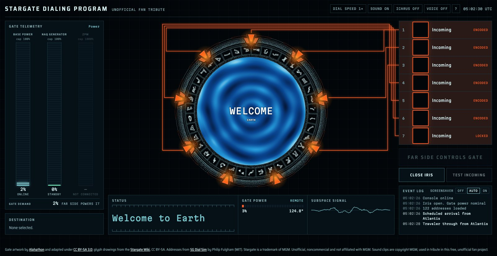
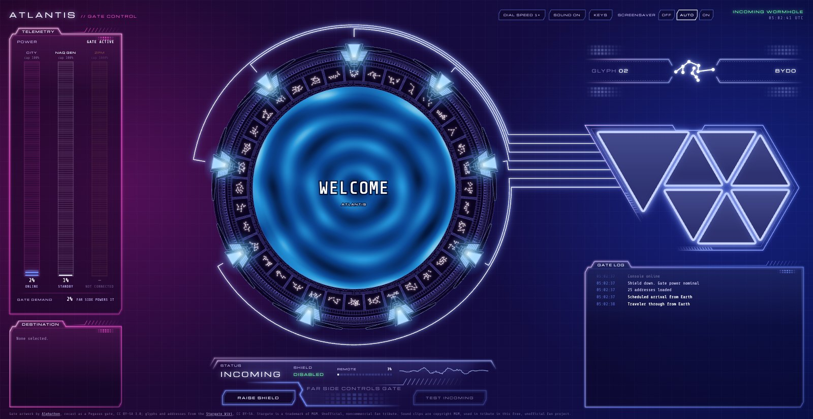
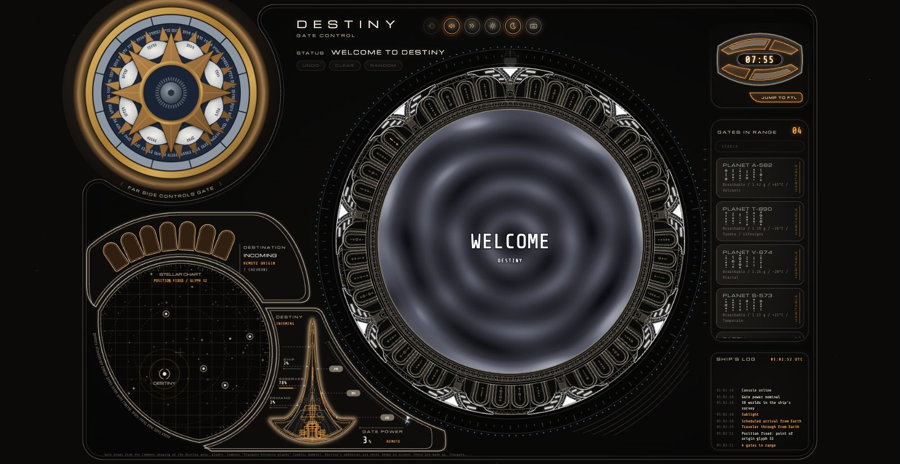
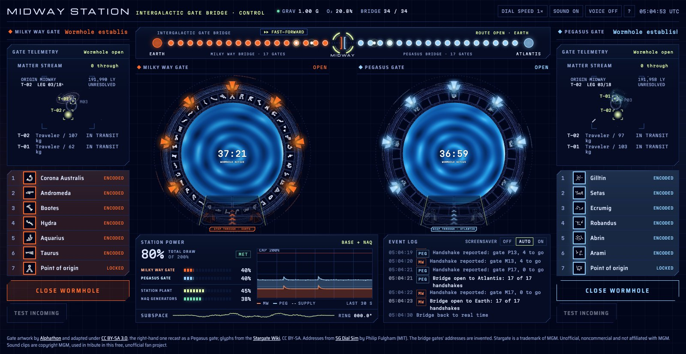

<h1 align="center">Stargate Dialer Screensaver</h1>

The gate rooms of Stargate Command, Atlantis, Destiny and Midway Station, dialing by themselves on your Mac.

  <a href="https://github.com/schultzisaiah/stargate-dialer-screensaver/releases/latest"><b>Download for Mac</b></a>
  &nbsp;·&nbsp;
  <a href="https://schultzisaiah.github.io/stargate-dialer/">Try it in your browser</a>

  

A screensaver made of four working dialing consoles from the shows: Stargate Command's computer from SG-1, the Atlantis gate room's screens, the bridge display aboard Destiny, and Midway Station, the outpost halfway between the Milky Way and Pegasus. Each one runs on its own: it dials addresses from its address book, locks chevrons, opens wormholes, sends teams and probes through, and takes incoming wormholes, with its shield or iris going up when it should.

Every few minutes, a console dials one of the others' homes, the way into the gate opens, and you step through: the wormhole's flight plays, and you arrive on the far side at the other console, which carries on from there. So it tours all four, starting on a different one each time.

  
  

Midway Station has two gates, one for each galaxy, and reaches the other gates by way of the intergalactic gate bridge: 17 gates strung out across the void on each side, each passing travelers on to the next. Trips to and from Midway cross the bridge gate by gate, and the consoles at either end follow travelers all the way.

  

## Install

1. [Download](https://github.com/schultzisaiah/stargate-dialer-screensaver/releases/latest) `Stargate-screensaver.zip`.
2. Open the zip and double-click `Stargate.saver`. Choose to install it for you or for all users.
3. Pick **Stargate** in System Settings → Screen Saver.

It's signed and notarized by Apple, so it installs without any warnings. It needs macOS 14 (Sonoma) or later, on Apple silicon or Intel.

To remove it, right-click it in System Settings → Screen Saver and choose Delete.

## Questions and problems

[Open an issue](https://github.com/schultzisaiah/stargate-dialer-screensaver/issues) here.

## A fan project

This is an unofficial fan tribute, free and noncommercial: it isn't sold, carries no ads and takes no donations. It is not affiliated with, endorsed or sponsored by MGM or Amazon MGM Studios. Stargate, Stargate SG-1, Stargate Atlantis and Stargate Universe, and their names, designs and sounds, are the property of MGM; they appear here only as an affectionate homage, without permission, and nothing here claims any right to them. If you hold rights to anything here and want it changed or removed, open an issue and it will be.

**Credits**
- Gate artwork: [Stargate.svg](https://commons.wikimedia.org/wiki/File:Stargate.svg) by Alphathon, Wikimedia Commons, CC BY-SA 3.0. The adapted artwork (split into layers, recolored, recast as the Pegasus gate) is shared under the same license.
- Milky Way and Pegasus glyphs, and Pegasus addresses: the [Stargate Wiki](https://stargate.fandom.com/wiki/Glyph), CC BY-SA.
- Milky Way addresses: [SG Dial Sim](https://github.com/kc7zax/sg-dial-sim) by Philip Fulgham, MIT License.
- Destiny's glyphs: Wikimedia Commons, "Stargate Universe glyphs", public domain.
- Sound clips are from the shows and copyright MGM, used here as part of the tribute. They came by way of [SG Dial Sim](https://github.com/kc7zax/sg-dial-sim), [adcox/stargate-dialing-computer](https://github.com/adcox/stargate-dialing-computer), [UXVirtual/sgdialer](https://github.com/UXVirtual/sgdialer) and 101soundboards.
